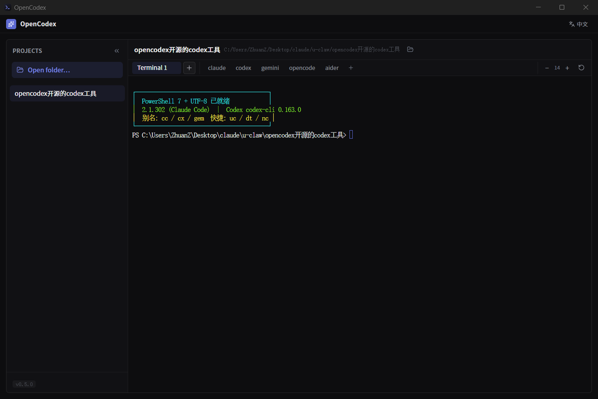

<div align="center">


# CliFleet

**English** · [简体中文](./README.zh.md)

### A ~3 MB native workbench for running several AI coding CLIs side by side — one folder, many agents, all alive.

[](./LICENSE)
[](https://github.com/dongsheng123132/clifleet/releases/latest)
[](https://github.com/dongsheng123132/clifleet/actions/workflows/release.yml)
[](https://tauri.app)


</div>

CliFleet is a minimal folder-based CLI workbench: pick a project folder → the main area **is a real in-app terminal** where you run Claude Code, Codex, opencode, pi, or any CLI → open one tab per agent when you want several running in parallel on the same repo. Everything stays alive — switching projects or tabs never kills your terminal processes.

**Fully local, open-source, no keys, no server.** CliFleet ships no API keys and points at no relay of its own. Model and endpoint configuration lives **inside your own CLIs** (via cc-switch, magpie, or the CLI's own config) — the terminal inherits your environment exactly as-is and never injects model or proxy variables.



## Why another AI workbench?

Most agent terminals (cmux, CliDeck, Warp, the official Codex app) bundle an agent, an editor or a web dashboard — and several need Node, a browser tab, or a localhost server to run. CliFleet is deliberately **just the shell**:

- **Nothing underneath.** One native binary (Tauri 2, ~3 MB, reuses the system WebView). No Node runtime, no background server, no `localhost:4000` tab.
- **Portable by default.** Keep data next to the exe (`portable-data/`) and the whole thing lives on a USB stick — no admin rights, no installer, no traces on a shared machine.
- **It never touches your configuration.** No telemetry, no env injection, no rewriting `~/.claude` or your CLI configs. Your agents don't know it's there.

If you want built-in orchestration — automatic hand-offs between agents, mobile remote, cost dashboards — CliDeck or Conductor already do that, and they do it well. CliFleet only gives you the window, and stays out of the way.

## Highlights

- **🗂️ Folder-based projects** — one folder per project on the left; pick a folder and it becomes a project. Click the path to copy it, or open the folder in your file explorer.
- **🖥️ Real multi-terminal tabs** — each tab is a real PTY (`portable_pty`) rendered by xterm.js with **WebGL**, smooth under high-frequency TUI repaints. Switching tabs/projects keeps processes running. Closing a terminal **kills the whole child-process tree** — no orphaned `pwsh`/`claude` processes piling up.
- **⚡ Works with your CLIs** — PATH fallback dirs (npm global, `~/bin`, homebrew…) are **appended, never prepended**, so your preferred CLI implementations keep priority. `claude` / `codex` just work.
- **⌨️ Terminal that's actually usable** — Ctrl/Cmd+C copy with selection, Ctrl+V / Shift+Insert / right-click paste, select-to-copy, adjustable font (`Ctrl ±`), drag & drop files/folders to insert paths, and a soft reset (`Ctrl+Shift+R`) that clears TUI crash residue (mouse garbage, screen artifacts, lost cursor) without touching your shell.
- **🚀 Custom quick commands** — launch your favorite CLIs with one click; add, rename, or remove buttons (stored locally).
- **🫳 Drag to drop paths** — drag a file / image / folder into the terminal and its real path is typed into the command line.
- **🪶 Portable** — ~3 MB binary (size-first Rust profile: `opt-level=z` + LTO + strip), reusing the system WebView (no bundled Chromium). Data follows the exe (`portable-data/`) or stays in `~/.clifleet`.

## Install

Download from [Releases](https://github.com/dongsheng123132/clifleet/releases/latest):

| Platform | Artifact |
|---|---|
| Windows x64 | `CliFleet-v*-windows-x64-setup.exe` (installer) or `*-portable.zip` (unzip & run) |
| macOS Apple Silicon | `CliFleet-v*-macos-arm64.dmg` |
| macOS Intel | `CliFleet-v*-macos-x86_64.dmg` |
| Linux x64 | `CliFleet-v*-linux-x86_64.AppImage` / `.deb` |

Every release includes `SHA256SUMS.txt` for verification. Builds are currently unsigned (macOS builds are ad-hoc signed only, not notarized) — Windows SmartScreen and macOS Gatekeeper may show a warning on first launch. Free OSS code signing is planned; see [docs/signing.md](docs/signing.md).

On macOS, if the first launch says the developer cannot be verified: System Settings → Privacy & Security → **Open Anyway**, or run `xattr -dr com.apple.quarantine /Applications/CliFleet.app` in Terminal.

Windows needs the WebView2 runtime (bundled with Windows 11 and most Windows 10 machines; the app offers to install it when missing). If the window never appears, update or reinstall the WebView2 runtime first — very old runtimes fail to create the window.

## Quick start

```bash
pnpm install            # install frontend deps
pnpm tauri dev          # dev mode (window + HMR)
pnpm tauri build        # produce exe + installer
```

Headless self-tests (no GUI):

```bash
cargo run -- --term-test "node --version"   # PTY + PATH injection
cargo run -- --term-kill-test               # process-tree cleanup on close
```

## Usage

1. Launch CliFleet.
2. **Open folder…** → pick a project folder → it appears in the project list.
3. Run any CLI in the terminal — `claude`, `codex`, `opencode`, `pi`… or click a quick command. Add your own quick commands with the `+` button (right-click a button to remove it).
4. Open more terminal tabs with `+`; close with the tab's `×` (click twice to confirm).

## Stack

Two layers, no sidecar: **React (WebView) ⟷ Tauri 2 (Rust)**.

## Data locations

Data root (first match wins): `CLIFLEET_HOME` env → `portable-data/` next to the exe (portable/U-Disk) → `~/.clifleet`.

- `<data root>/tasks.json` — project list
- `<data root>/logs/clifleet.jsonl` — local bug log (purely local, never uploaded)

Upgrading from v0.5 (formerly OpenCodex)? The old `~/.opencodex` folder and `OPENCODEX_HOME` variable are still honoured; `~/.opencodex` is moved to `~/.clifleet` on first launch.

## License

[MIT](./LICENSE). No bundled keys, billing, activation, or telemetry — a pure local tool.

> "Claude" / "Claude Code" are trademarks of Anthropic; "Codex" is a trademark of OpenAI. Other CLIs (Gemini CLI, Aider, opencode) belong to their respective owners. CliFleet is an independent open-source project, not affiliated with or endorsed by any of them, and only runs the AI CLIs and model endpoints you configure yourself.
