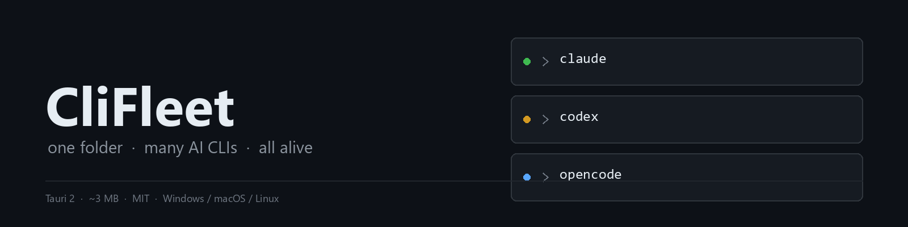
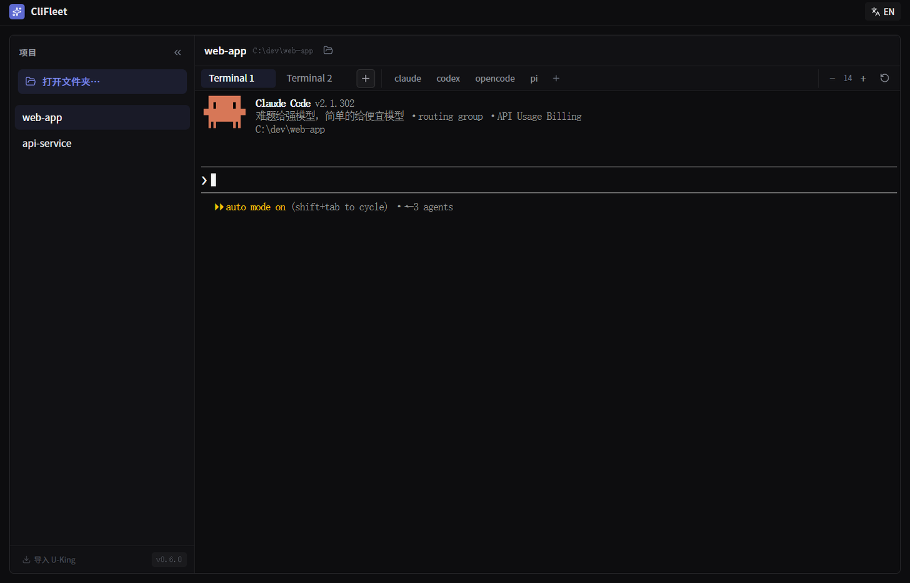
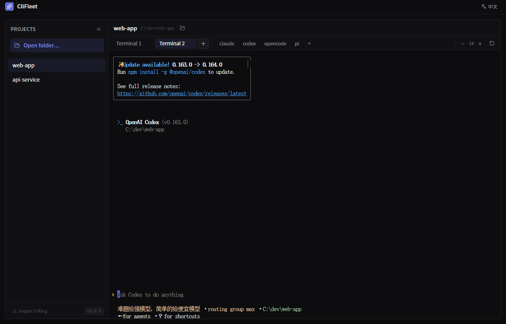
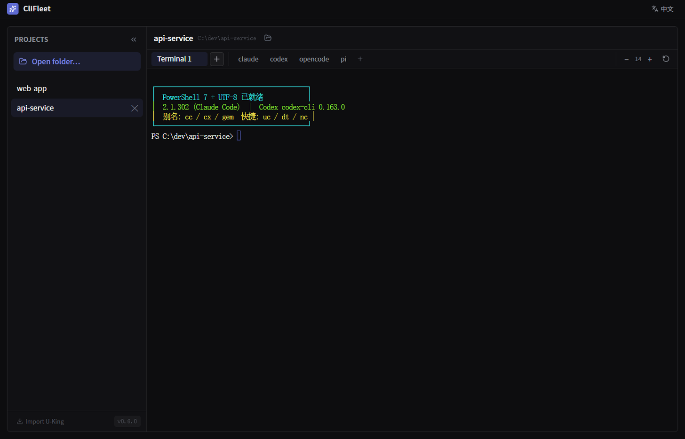

<div align="center">



# CliFleet

[English](./README.md) · **简体中文**

### 约 3 MB 的原生工作台 —— 一个文件夹里同时跑多个 AI 编程 CLI，进程全程保活。

[](./LICENSE)
[](https://github.com/dongsheng123132/clifleet/releases/latest)
[](https://github.com/dongsheng123132/clifleet/actions/workflows/release.yml)
[](https://tauri.app)


</div>

CliFleet 是一个极简的「基于文件夹的 CLI 工作台」：选一个项目文件夹 → 主区就是**应用内真终端**，跑 Claude Code / Codex / opencode / pi 或任意 CLI → 想让几个 agent 同时干同一个仓库，就一个 agent 开一个标签。全程保活——切项目、切标签都不杀进程。

**完全本地、开源、无内置 Key、无服务器。** 模型与端点配置放在**你自己的 CLI 里**（cc-switch、magpie 或 CLI 自带配置都行）——终端完整继承你的环境，**不注入任何模型/代理变量**。



真机截图：同一个项目文件夹里，标签 1 跑 `claude`，标签 2 跑 `codex`；切标签两边都不中断。

|  |  |
|---|---|
| 任意 CLI 都能跑——直接继承你的环境 | 一个文件夹 = 一个项目；切项目时终端全部保活 |

**官网（中 / 英）：<https://clifleet.vercel.app>**

## 为什么还要一个 AI 工作台？

现在的 agent 终端（cmux、CliDeck、Warp、官方 Codex app）大多把 agent、编辑器或网页面板一起打包，其中好几个还得装 Node、开浏览器标签、起一个本地服务。CliFleet 反过来做：**它只是一层壳**。

- **底下什么都不用装。** 单个原生二进制（Tauri 2，约 3 MB，复用系统 WebView）。不需要 Node 运行时，不起后台服务，不开 `localhost:4000` 的页面。
- **天生便携。** 数据放 exe 旁边的 `portable-data/`，整个文件夹拷进 U 盘就能走——免管理员权限、免安装包、不在共用机器上留痕。
- **绝不碰你的配置。** 无遥测、不注入环境变量、不改写 `~/.claude` 或你的 CLI 配置。你的 agent 甚至不知道它在。

如果你要的是内置编排——agent 之间自动交接、手机远程、成本看板——CliDeck、Conductor 已经做得更好。CliFleet 只给你那个窗口，然后从你眼前消失。

## 特性

- **🗂️ 基于文件夹的项目** —— 左侧一文件夹一项目；点路径即复制，也可一键在资源管理器中打开。
- **🖥️ 真·多终端标签** —— 每个标签是真 PTY（`portable_pty`）+ xterm.js **WebGL** 渲染，TUI 高频重绘也顺滑。切标签/切项目进程照跑；关终端**杀整棵进程树**，不留 `pwsh`/`claude` 孤儿。
- **⚡ 和你的 CLI 无缝配合** —— PATH 兜底目录（npm 全局、`~/bin`、homebrew…）**只追加不前置**，你优先装的 CLI 永远优先。`claude` / `codex` 直接能跑。
- **⌨️ 真正好用的终端** —— 有选区 Ctrl+C 复制、Ctrl+V / Shift+Insert / 右键粘贴、选中即复制、字号可调（`Ctrl ±`）、拖文件/文件夹插入路径、软重置（`Ctrl+Shift+R`）一键清掉 TUI 崩溃残留（鼠标乱码、花屏、光标丢失），不碰 shell。
- **🚀 自定义快捷词** —— 一键启动常用 CLI；可增删改（本地保存）。
- **🫳 拖放落路径** —— 把文件/图片/文件夹拖进终端，真实路径自动敲进命令行。
- **🪶 极轻量** —— 约 3 MB（Rust 体积优先：`opt-level=z` + LTO + strip），复用系统 WebView（不带 Chromium）。数据跟程序走（`portable-data/`）或留在 `~/.clifleet`。

## 安装

### 一行命令

**Windows**（PowerShell）：

```powershell
irm https://u-claw.org.cn/clifleet/install.ps1 | iex
```

**macOS / Linux**：

```sh
curl -fsSL https://u-claw.org.cn/clifleet/install.sh | sh
```

脚本会自动取最新版本、校验 `SHA256SUMS.txt`、GitHub 慢时逐个镜像重试，装完不改系统环境变量。

**重复执行同一条命令就是升级** —— 项目列表和设置存在 `~/.clifleet`，不会被覆盖。

**绿色版（免安装）** —— 解压到任意目录，一行命令生成桌面快捷方式（不安装、不写注册表、不要管理员）：

```powershell
irm https://u-claw.org.cn/clifleet/shortcut.ps1 | iex
```

放在自定义目录的：把脚本下载到本地后跑 `powershell -File shortcut.ps1 -Exe "D:\CliFleet\CliFleet.exe"`。后续版本的绿色 ZIP 里也自带 `Create-Desktop-Shortcut.cmd`，双击即可。
镜像：**<https://u-claw.org.cn/clifleet/>**（国内、已备案、直连快）· <https://clifleet.vercel.app>（海外）。安装脚本默认先走国内源，失败自动回退 GitHub。

### 或者让 AI 助手帮你装

把下面这段粘给 Claude Code / Codex / 任何有终端权限的助手：

```
请帮我安装 CliFleet（开源的 AI CLI 多终端工作台），按顺序做：

1. Windows 执行：irm https://u-claw.org.cn/clifleet/install.ps1 | iex
   macOS/Linux 执行：curl -fsSL https://u-claw.org.cn/clifleet/install.sh | sh
2. 上面是国内源（备案域名、直连快）；如果失败，再换 https://clifleet.vercel.app 或 GitHub Releases 重试。
3. 重复执行同一命令即升级，项目列表与设置保留在 ~/.clifleet，不要删除它。
4. 不要修改我的任何模型配置、API Key、代理和环境变量；
   CliFleet 只是终端窗格，claude / codex 等 CLI 的配置保持原样。
```

### 手动下载

从 [Releases](https://github.com/dongsheng123132/clifleet/releases/latest) 下载：

| 平台 | 产物 |
|---|---|
| Windows x64 | `CliFleet-v*-windows-x64-setup.exe`（安装包）或 `*-portable.zip`（解压即用） |
| macOS Apple 芯片 | `CliFleet-v*-macos-arm64.dmg` |
| macOS Intel | `CliFleet-v*-macos-x86_64.dmg` |
| Linux x64 | `CliFleet-v*-linux-x86_64.AppImage` / `.deb` |

每个 Release 附 `SHA256SUMS.txt` 供校验。当前为**未签名构建**（macOS 包仅 ad-hoc 签名、未公证），首次运行 Windows SmartScreen / macOS Gatekeeper 可能提示。免费开源签名在路上，见 [docs/signing.md](docs/signing.md)。

macOS 首次打开若提示「无法验证开发者」：系统设置 → 隐私与安全性 → 点「仍要打开」；或在终端执行 `xattr -dr com.apple.quarantine /Applications/CliFleet.app`。

Windows 需要 WebView2 运行库（Win11 与多数 Win10 自带，缺失时应用会提示安装）。**如果窗口一直不出现，先升级/重装 WebView2 运行库**——过旧的版本会导致窗口创建失败。

## 快速开始

```bash
pnpm install            # 装前端依赖
pnpm tauri dev          # 开发模式（弹窗 + HMR）
pnpm tauri build        # 出 exe + 安装包
```

无头自检（不依赖 GUI）：

```bash
cargo run -- --term-test "node --version"   # PTY + PATH 注入
cargo run -- --term-kill-test               # 关闭时进程树清理
```

## 使用

1. 启动 CliFleet。
2. **打开文件夹…** → 选项目文件夹 → 出现在项目列表。
3. 终端里跑任意 CLI —— `claude`、`codex`、`opencode`、`pi`… 或点快捷词一键启动；`+` 可添加自定义快捷词（右键按钮删除）。
4. `+` 多开终端标签；点标签上的 `×`（点两下确认）关闭。

## 配合 U-King 用更方便

[U-King](https://github.com/dongsheng123132/u-king) 负责「装」的那一半：识别并安装 AI CLI、把每个工具的端点配置理顺。CliFleet 负责每天用的那一半：开窗、托管终端，然后消失。项目列表可以从 U-King 工作台一键导入（左下角按钮）。

## 技术栈

两层，无 sidecar：**React（WebView）⟷ Tauri 2（Rust）**。

## 数据位置

数据根（优先级）：`CLIFLEET_HOME` 环境变量 → exe 旁 `portable-data/`（绿色包/U 盘）→ `~/.clifleet`。

- `<数据根>/tasks.json` —— 项目列表
- `<数据根>/logs/clifleet.jsonl` —— 本地 bug 日志（纯本地，绝不上传）

从 v0.5（原名 OpenCodex）升级？旧的 `~/.opencodex` 目录和 `OPENCODEX_HOME` 变量仍然兼容：首次启动会把 `~/.opencodex` 整体改名为 `~/.clifleet`，项目列表不丢。

## 许可证

[MIT](./LICENSE)。无内置 Key、无计费、无激活、无遥测——纯本地工具。

> "Claude" / "Claude Code" 是 Anthropic 的商标；"Codex" 是 OpenAI 的商标。其他 CLI（Gemini CLI、Aider、opencode）归各自所有者。CliFleet 是独立开源项目，与上述各方无关，仅运行你自己配置的 CLI 与端点。
